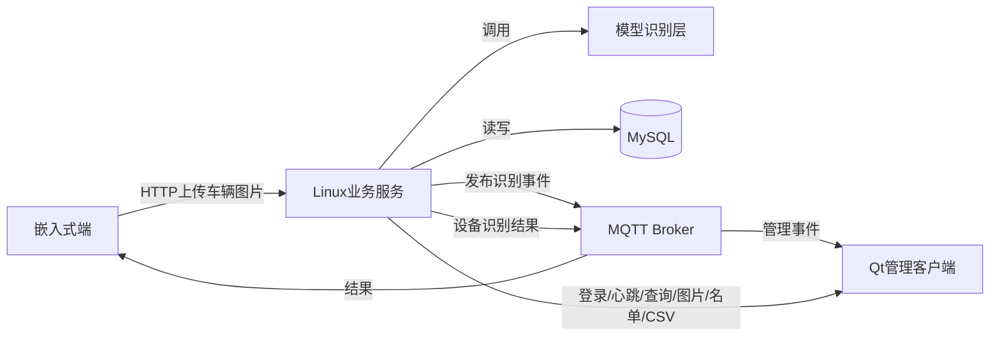
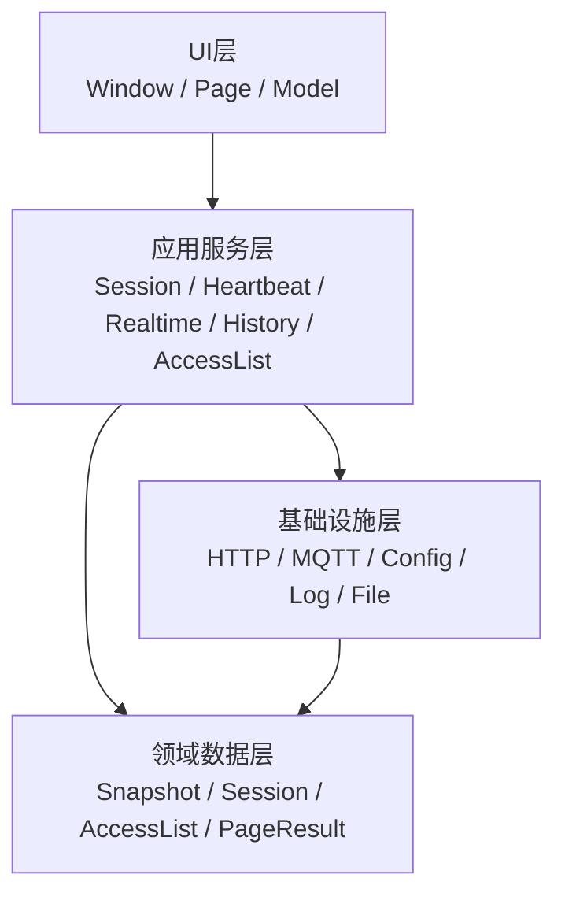
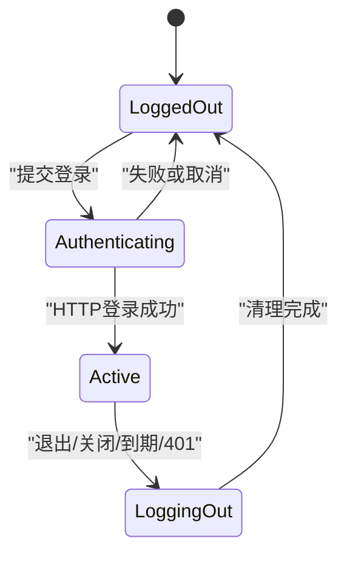
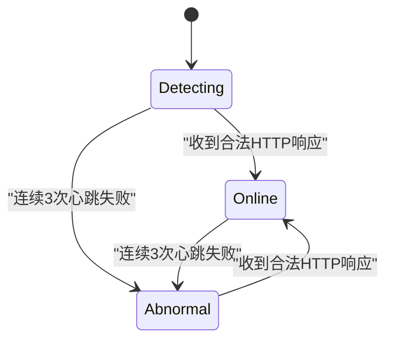
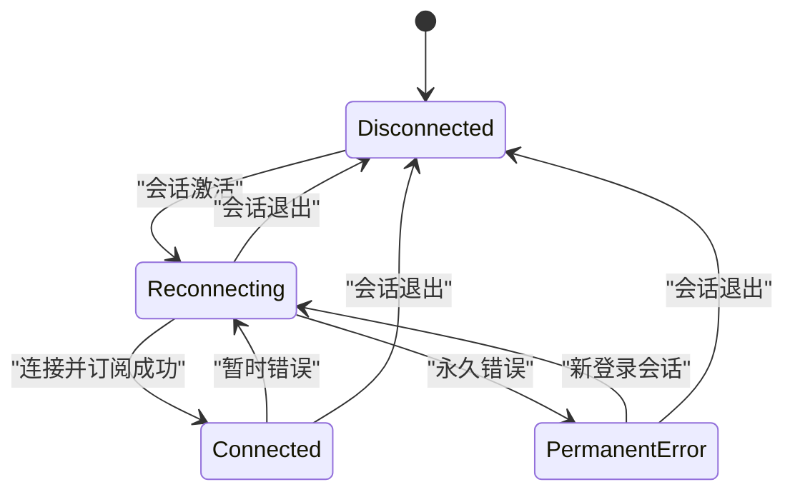
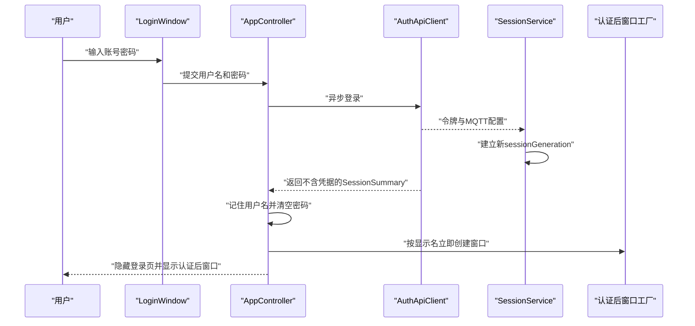
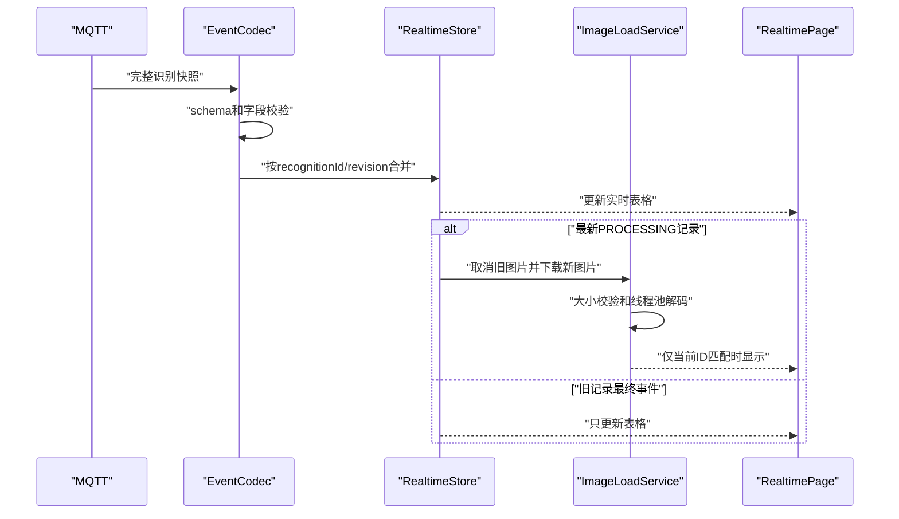
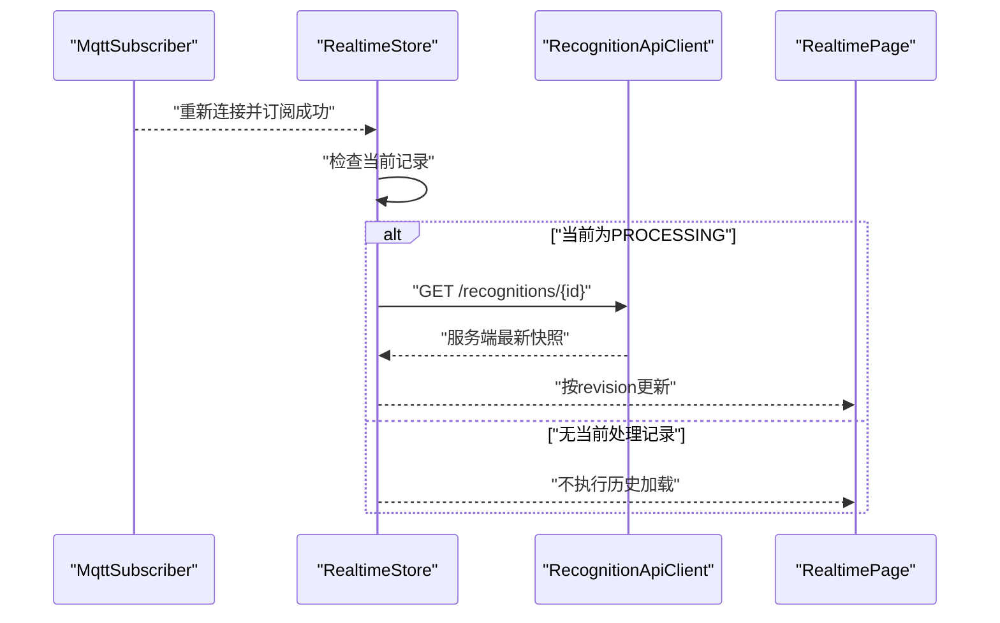

# REQ-001 Qt 车牌识别管理客户端架构设计

| 属性 | 内容 |
| --- | --- |
| 关联需求 | REQ-001 v2.1 |
| 设计版本 | 1.1 |
| 状态 | 已确认，待实现 |
| 日期 | 2026-08-11 |

## 1. 设计目标

本设计用于指导 Qt 管理客户端的后续实现，目标是：

- 保持教学项目结构清晰，不过度抽象。
- 明确 Linux 服务端负责识别和业务数据，Qt 只做管理与展示。
- 使用 Qt 异步能力保证 UI 响应。
- 防止旧网络响应、旧图片和旧登录会话污染当前界面。
- 不使用 SQLite，不建立客户端业务同步系统。
- 让每个模块可以通过可控 HTTP/MQTT Mock 独立测试。

## 2. 架构原则

1. 单进程、事件驱动、模块化单体。
2. UI 与协议解析分离，QWidget 不直接构造 HTTP/MQTT 数据。
3. Linux 服务端是识别日志和名单数据的唯一业务来源。
4. MQTT 负责实时通知，HTTP 负责可查询资源和写操作。
5. 实时页面是会话视图，不承担历史可靠存储。
6. 所有异步结果必须经过会话和请求代次验证。
7. 优先使用 Qt 模块，不引入额外运行时框架。

## 3. 系统上下文



Qt 客户端不位于服务端到嵌入式端的结果路径中。Qt 关闭不影响模型识别或嵌入式抬杆流程。

## 4. 客户端分层



依赖只允许从 UI 指向应用服务、从应用服务指向基础设施和领域数据。领域数据不得依赖 QWidget、QNetworkReply 或 QMqttClient。

## 5. 模块设计

### 5.1 应用入口

| 模块 | 职责 |
| --- | --- |
| `Application` | 校验启动配置，并在校验通过后按所有权顺序创建日志、HTTP、认证、会话、设置和控制器对象 |
| `AppController` | 创建登录页；协调异步登录、用户名设置和认证后窗口生命周期 |
| `BootstrapConfigLoader` | 加载并校验 `client.json`，拒绝非法 URL、UUID 和传输配置 |

程序入口负责设置 Qt 组织名、应用名和版本，再调用 `Application`。非法配置通过阻断式错误提示终止启动，且在校验通过前不创建日志、HTTP、认证、会话或 `QSettings` 对象。

TASK-008 的认证后窗口由 `AppController::WindowFactory` 注入；默认工厂仅创建不含导航、状态或页面的最小承接窗口。TASK-009 将默认工厂替换为正式 `MainWindow`，登录控制流程和窗口工厂契约保持不变。

TASK-015 由 `Application` 持有 `ImageLoadService`。成员和对象生命周期按“图片服务依赖 → `ImageLoadService` → controller/window”建立，销毁时反向执行，确保窗口和 `RealtimePage` 先断开并销毁，图片服务随后取消请求，最后才释放其 HTTP、会话等依赖。默认窗口工厂把同一 `RealtimeRecognitionStore` 和 `ImageLoadService` 注入 `MainWindow`，再由 `MainWindow` 注入 `RealtimePage`，页面不得自行创建业务服务。

### 5.2 会话和连接

| 模块 | 职责 |
| --- | --- |
| `AuthApiClient` | 登录、注销、JSON 信封校验和认证错误映射 |
| `SessionService` | 保存内存会话、到期计时、会话代次和统一失效处理 |
| `HeartbeatService` | 30 秒心跳、5 秒超时、连续失败计数和 HTTP 状态通知 |
| `MqttRecognitionSubscriber` | MQTT 连接、重连、订阅、事件解析和连接状态通知 |

`SessionService` 是访问令牌和 MQTT 凭据的唯一所有者。UI 只能获得显示名、到期提示和连接状态，不得读取或记录凭据。
`AuthApiClient` 登录成功后直接把完整 `SessionContext` 移交给 `SessionService`，只向调用方返回不含凭据的 `SessionSummary`。HTTP/MQTT 基础设施按当前会话代次通过短生命周期回调临时使用凭据，不返回可长期保存的凭据副本。

### 5.3 实时识别

| 模块 | 职责 |
| --- | --- |
| `RecognitionApiClient` | 查询单条记录、分页历史、下载图片和下载 CSV |
| `RecognitionEventCodec` | 校验 MQTT schema 并转换为 `RecognitionSnapshot` |
| `RealtimeRecognitionStore` | revision 去重、当前车辆选择和最近 100 条会话记录 |
| `ImageLoadService` | 当前图片下载、取消、重试、大小校验和异步解码 |
| `ReconnectReconciler` | MQTT 重连后只查询当前 `PROCESSING` 记录 |

### 5.4 历史和名单

| 模块 | 职责 |
| --- | --- |
| `HistoryService` | 组织筛选、分页和请求代次，向页面提供不可变分页结果 |
| `CsvDownloadService` | 接收已确认目标路径和历史筛选快照，请求服务端 CSV、流式写入、上下文校验、取消和原子提交 |
| `AccessListApiClient` | 名单分页查询、精确查询、新增和删除；保留 404/409 稳定 API 语义并通知当前会话 401 |
| `AccessListService` | 车牌和关键字规范化、独立查询/写上下文、单活动写保护、超时三态核实和确定结果后的查询刷新 |

TASK-018 将上述两个模块放入独立的名单静态库，仅由 Qt Core、HTTP、认证和协议层支撑；本任务不把名单服务注入 `Application`、`MainWindow` 或任何 QWidget。UI 和应用组合从 TASK-019 开始接入。

### 5.5 UI

| 界面 | 职责 |
| --- | --- |
| `LoginWindow` | 用户名、掩码密码、提交状态和安全错误提示；只发出登录交互信号，不拼装协议 |
| `MainWindow` | 渐变自绘标题栏、最大化窗口、左侧导航、页面容器和关闭事件 |
| `NavigationSidebar` | 导航、用户、HTTP/MQTT 状态、版本和退出 |
| `RealtimePage` | 当前图片、当前状态、结果信息和实时表格 |
| `HistoryPage` | 时间/设备筛选、历史分页表格和 CSV 保存对话框；只把用户确认的路径及最后已提交筛选交给服务 |
| `AccessListPage` | 黑白名单标签、搜索、分页、新增和删除 |
| `RecognitionTableModel` | 实时或历史只读表格模型 |
| `AccessListTableModel` | 名单只读表格模型 |

`RealtimePage` 只订阅 `RealtimeRecognitionStore` 和 `ImageLoadService` 的信号，不解析 MQTT、不构造 HTTP 请求，也不复制业务状态机。`RecognitionTableModel` 以实时或历史模式只读映射对应服务提供的 `items`，不维护独立业务副本；图片服务返回的 `QImage` 仅在 `RealtimePage` 所在线程再次核对当前记录后转换为 `QPixmap`。

`AccessListPage` 使用单一 `AccessListService` 映射当前标签的服务端分页，不在模型或页面中本地插入、删除或复制名单记录。首次显示默认查询空关键字的白名单第一页；页面切离时取消在途分页查询，重新显示时刷新最后已提交查询。切换白名单/黑名单标签时清空未提交关键字并查询新类型第一页；搜索和重置回到第一页，刷新和翻页只使用最后已提交条件。

新增对话框显示当前名单类型，只收集车牌号和可选备注；写操作活动期间禁止重复提交和第二个页面写操作。删除只针对当前选中记录，确认框同时显示名单类型和车牌号。页面仅在 Service 返回 `Applied` 或 `AlreadyAbsent` 后等待服务刷新；若删除后服务端返回的当前页为空且页码大于 1，再查询前一页。`NotApplied`、`Unknown`、`Busy` 和其他错误只显示非阻断提示并保留原表格。

`LoginWindow` 固定为 `520×420` 逻辑尺寸，使用 `44px`、`#1F5F99` 的 Qt 自绘标题栏并提供拖动、最小化和关闭，不提供最大化或缩放。主体使用浅灰背景；Logo 标题组合居中，用户名和密码行按图标、左对齐标签、输入框三列对齐，登录按钮固定为 `220×48` 并靠近底部。错误提示预留稳定区域，不得引起按钮位移。

登录图片统一位于 `src/ui/resources/images/login`，由 `src/ui/resources/plate_client.qrc` 以 `:/images/login/...` 路径编译进 `plate_client_ui`。UI 库显式初始化资源，应用和独立 UI 测试均不得依赖当前工作目录。

`MainWindow` 使用 `44px` Qt 自绘标题栏替代 Windows 原生标题栏，背景从左侧 `#2A5B78` 到右侧 `#3C7898` 横向渐变，标题文字固定为 `#FFFFFF`。标题栏提供最小化、最大化/还原和关闭按钮，支持拖动及双击最大化/还原；无边框窗口在普通状态下通过 Windows 非客户区命中测试保留 DPI 感知的边缘缩放，最大化时禁用缩放命中。该实现只负责窗口交互，不改变关闭清理流程的 TASK-020 边界。

视频识别和摄像头识别使用禁用的导航项，不创建空白业务页面。

## 6. 建议源码目录

```text
src/
├── app/             Application、AppController
├── domain/          Session、RecognitionSnapshot、AccessListRecord、错误类型
├── services/        Session、Heartbeat、Realtime、History、AccessList服务
├── infrastructure/
│   ├── config/      引导配置
│   ├── http/        HTTP客户端适配器
│   ├── mqtt/        Qt MQTT适配器和事件解析
│   ├── files/       CSV保存和日志文件
│   └── logging/     脱敏按日日志
└── ui/
    ├── windows/     登录和主窗口
    ├── pages/       实时、历史和名单页面
    ├── models/      QAbstractTableModel实现
    └── widgets/     状态指示器等可复用控件
```

该目录是模块边界，不要求为每个类型单独建立文件。实现应避免只有一次调用的空接口和无业务价值的抽象层。

## 7. 核心数据类型

### 7.1 `BootstrapConfig`

- `clientId`
- `loginBaseUrl`
- `allowInsecureTransport`

该类型是只提供只读访问的不可变值对象。加载器严格拒绝三个规定字段之外的任何字段；`loginBaseUrl` 可包含路径前缀，但不得包含查询参数、片段或用户信息。加载失败只返回可展示错误，不产生部分配置对象或隐式服务器地址。

### 7.2 `SessionContext`

| 字段 | C++/Qt 类型 | 说明 |
| --- | --- | --- |
| `displayName` | `QString` | 当前用户显示名 |
| `accessToken` | `QString` | Bearer Token |
| `expiresAt` | `QDateTime` | 带 `+08:00` 的有效期 |
| MQTT 主机、用户名、密码、主题 | `QString` | 登录响应下发 |
| MQTT 端口 | `quint16` | 1 至 65535 |
| MQTT TLS | `bool` | 是否启用 TLS |
| `generation` | `quint64` | 登录会话代次 |

`SessionContext` 只存在内存中。销毁或替换会话时清空敏感字符串。
该类型不可复制，只允许移动；访问令牌、MQTT 用户名和密码在销毁、替换或移动后显式覆盖清空。

登录协议编解码先生成 `generation=0` 的 `SessionContext`；`SessionService` 在建立会话时替换为实际正数代次，协议层不得自行生成会话代次。
未登录状态下仅 `auth.login` 请求允许使用代次 `0`；建立会话后该登录上下文失效。会话摘要只包含显示名、到期时间和正数代次。

### 7.3 `RecognitionSnapshot`

| 字段 | C++/Qt 类型 |
| --- | --- |
| `schemaVersion` | `int` |
| `recognitionId` | `QString` |
| `revision` | `qint64` |
| `deviceId` | `QString` |
| `status` | `RecognitionStatus` 枚举 |
| `plateNumber` | `std::optional<QString>` |
| `errorCode` | `std::optional<QString>` |
| `errorMessage` | `std::optional<QString>` |
| `capturedAt` | `QDateTime` |
| `startedAt` | `QDateTime` |
| `completedAt` | `std::optional<QDateTime>` |
| `durationMs` | `std::optional<qint64>` |

状态限定为 `PROCESSING`、`SUCCEEDED` 和 `FAILED`。解析器必须按 REQ-001 第 8.4 节同时校验字段类型、范围和状态相关可空性，不把缺失字段与显式 `null` 混为一类。

### 7.4 `AccessListRecord`

| 字段 | C++/Qt 类型 |
| --- | --- |
| `id` | `qint64` |
| `listType` | `AccessListType` 枚举 |
| `plateNumber` | `QString` |
| `remark` | `QString` |
| `createdBy` | `QString` |
| `createdAt` | `QDateTime` |

名单类型限定为 `WHITE` 和 `BLACK`。`plateNumber` 长度和 `remark` 上限按 Unicode 码点计数，不按 UTF-16 code unit 计数。`remark` 始终是字符串，未填写时为空字符串，协议层不接受 `null`。

### 7.5 `RequestContext`

- `sessionGeneration`
- `requestGeneration`
- 页面或操作类型
- 可选 `recognitionId`
- 当前筛选条件快照

每个异步响应必须携带或闭包捕获不可变 `RequestContext`。

筛选条件快照使用按值保存的 `QVariantMap`；领域层不使用或暴露 `QJsonObject`。

名单查询和名单写使用彼此独立的递增 `requestGeneration`、活动请求句柄和不可变快照。分页查询快照固定包含 `listType/keyword/page/pageSize=100`；写快照固定包含操作类型、规范化车牌、目标名单类型，以及删除时的正数记录 ID。超时后的精确查询仍复用原写代次和写命令快照，只替换写通道的活动底层句柄，不建立第二个业务写操作。

### 7.6 HTTP DTO

基础设施层使用两个通用值类型，不向 UI 暴露 `QJsonObject`：

| 类型 | 字段 |
| --- | --- |
| `HttpEnvelope<T>` | `bool success`、`QString code`、`QString message`、`QString requestId`、`std::optional<T> data` |
| `PageResult<T>` | `QList<T> items`、`int page`、`int pageSize`、`qint64 total` |
| `EmptyResponse` | 无业务字段；用于成功信封要求 `data=null` 的接口 |

`page` 从 1 开始，`pageSize` 首版固定为 100，`total` 不得为负。历史 HTTP 适配器还必须验证响应 `page` 与请求 `page` 完全相同，不同则返回协议错误。HTTP 适配器负责把统一信封转换为明确的成功值或错误类型；应用服务和 QWidget 不得自行读取 JSON 字段。

各接口成功值固定为：

| 接口 | 成功 DTO |
| --- | --- |
| 登录 | `SessionContext` 所需的登录 DTO |
| 心跳、注销、删除名单 | `EmptyResponse`，协议层校验 `data=null` |
| 识别详情 | `RecognitionSnapshot` |
| 识别历史 | `PageResult<RecognitionSnapshot>` |
| 名单分页 | `PageResult<AccessListRecord>` |
| 名单精确查询、新增名单 | `AccessListRecord` |
| 图片、CSV | 不使用 JSON 信封的流式二进制响应 |

字段类型、可空性、状态约束、CSV 列顺序以及 2 MiB JSON 响应上限以 REQ-001 第 8 章为准。任何 DTO 解析失败均返回协议错误，不把部分对象交给应用服务。

协议编解码严格拒绝未知字段。由于 Qt JSON 数字以双精度表示，64 位 integer 只接受有限、无小数且绝对值不超过 `2^53-1` 的 JSON number。结构化协议错误固定包含稳定错误枚举、字段路径和可安全展示的消息。

## 8. 执行和线程模型

### 8.1 UI 线程

以下对象工作在 UI 线程：

- 所有 QWidget 和 QAbstractTableModel。
- `AppController` 和应用服务协调对象。
- `QNetworkAccessManager` 及其 QNetworkReply。
- `QMqttClient`。
- QTimer 心跳、令牌到期和 MQTT 重连调度。

QNetworkAccessManager 和 QMqttClient 本身是异步的，回调只执行解析、状态判断和信号分发，不做大图片解码或大批量数据转换。

### 8.2 线程池

线程池仅用于：

- 使用 `QImageReader` 预检并解码已下载图片字节为 `QImage`。
- 必要的非阻塞文件收尾操作。

后台结果通过 queued signal/slot 返回 UI 线程后仍需验证会话代次、图片请求代次和 `recognitionId`。线程池任务不得持有 QWidget 裸指针，也不得创建或访问 `QPixmap`；`QPixmap::fromImage()` 和界面设置只能在 UI 线程执行。

### 8.3 CSV 写入

CSV 由服务端生成。`RecognitionApiClient` 只为 `EF BB BF`、固定十列表头及其 CRLF 保留有界小缓冲，并严格验证唯一且语义精确的 `text/csv; charset=utf-8`：ASCII 大小写和参数周围可选空白可以归一，重复头、重复或未知参数以及非 `utf-8` 字符集必须拒绝；验证后的正文仍按网络数据块转发，不累计完整文件。

`CsvDownloadService` 在发起请求前先打开 `QSaveFile`，并调用 `setDirectWriteFallback(false)`，确保无法创建同目录临时文件时直接失败而不降级覆盖目标。数据块增量写入临时文件；最终 `commit()` 前同时验证当前会话代次、活动请求代次、活动句柄和不可变筛选快照。写入、下载、协议或提交失败，以及显式取消、会话失效、退出关闭或服务销毁时调用 `cancelWriting()`。原目标不存在时不产生目标文件，原目标存在时保留原内容，且不得留下 `QSaveFile` 临时文件。

### 8.4 HTTP 总时限和重试

HTTP 适配器在创建 `QNetworkReply` 时同时创建归属同一请求上下文的单次 `QTimer`，实现从请求发出到完整响应体接收完成的总时限。定时器到期时调用 `abort()`；完成、取消或销毁 reply 时停止定时器。超时必须映射为独立错误，不与用户取消混淆。

| 请求 | 总时限 | 客户端行为 |
| --- | ---: | --- |
| 登录 | 10 秒 | 不自动重试 |
| 注销 | 5 秒 | 不重试，不阻塞本地退出 |
| 心跳 | 5 秒 | 不立即重试，等待下一个 30 秒周期 |
| 识别详情、历史、名单分页和精确查询 | 10 秒 | 不自动重试 |
| 图片 | 每次尝试 30 秒 | 仅连接失败、超时或 HTTP 500/502/503/504 按 1 秒、3 秒重试；手动重试建立新的最多 3 次尝试系列 |
| 名单新增、删除 | 10 秒 | 不重发写请求，改用精确查询核实 |
| CSV | 120 秒 | 不自动重试 |

JSON reply 在读取前检查 `Content-Length`，读取过程中检查解码后的累计字节数，超过 2 MiB（`2 * 1024 * 1024` 字节）立即中止并报告响应超限。图片使用独立的 20 MiB 上限；CSV 成功响应直接转发网络数据块，不在 `HttpClient` 中累计完整内容。各模式的 4xx/5xx JSON 错误信封仍按 2 MiB 限制缓冲。

`HttpClient` 返回异步请求句柄和统一响应值；响应携带 HTTP 状态、响应头、内存响应体和原 `RequestContext`。错误稳定区分 4xx、5xx、网络、TLS、超时、取消、超限、解析、重定向和旧响应，并可附带 HTTP 状态、Qt 网络错误码或结构化协议错误。显式取消只回调一次取消结果；完成前使用注入的上下文校验器拒绝旧响应。传输层使用手动重定向策略并拒绝所有 3xx，避免 Bearer Token 被带到非预期地址。

图片请求额外设置 `QNetworkRequest::AlwaysNetwork` 和 `QNetworkRequest::CacheSaveControl=false`，生产代码不创建 `QNetworkDiskCache`。图片成功响应的媒体类型由图片 API 适配层校验：去除首尾 ASCII 空白后按 ASCII 大小写不敏感匹配，但不得带参数，且只能是 `image/jpeg` 或 `image/png`。

重连校准失败后不循环查询。HTTP 状态以后首次从“异常”恢复为“在线”时，若当前记录仍为 `PROCESSING`，`ReconnectReconciler` 只补偿查询一次；新的 MQTT 断线重连周期可以建立新的单次补偿资格。

## 9. 状态模型

### 9.1 会话状态



### 9.2 HTTP 状态



合法的 4xx/5xx 证明 HTTP 服务可访问，但具体请求仍按失败处理。401 额外触发会话退出。
每个 401 携带原请求的会话代次；`SessionService` 只接受当前代次的首次通知，重复通知和旧代次通知不再次触发失效信号。

### 9.3 MQTT 状态



只有 MQTT CONNECT 和主题订阅都成功后才进入 `Connected`。错误分类如下：

| 分类 | 错误 | 行为 |
| --- | --- | --- |
| 暂时错误 | 网络中断、连接超时、Broker 暂不可用 | 进入 `Reconnecting`，按 1、2、4 秒递增到 60 秒上限重连 |
| 永久错误 | 用户名或密码错误、无权限、Client ID 被拒绝、协议不支持、订阅失败、TLS 证书错误 | 进入 `PermanentError`，停止当前会话的重连定时器 |

`PermanentError` 在导航栏仍映射为 MQTT“未连接”，并附加“配置或授权错误”及脱敏原因。该状态不使 HTTP 会话失效，历史、CSV 和名单功能继续可用；只有创建新的登录会话后才清除该错误并再次连接。TLS 证书错误不得转为暂时错误或被忽略。

### 9.4 当前车辆状态

- 无当前记录：显示“未启动识别”。
- 当前快照为 `PROCESSING`：显示“识别中”。
- 当前快照为 `SUCCEEDED`：显示“已识别完成”和车牌号。
- 当前快照为 `FAILED`：显示“已识别完成”和红色错误信息。

## 10. 登录时序



认证后窗口展示不依赖 MQTT 连接完成。TASK-008 使用最小承接窗口；TASK-009 替换为最大化 `MainWindow`，TASK-010 和 TASK-011 再分别接入心跳和 MQTT 状态。

## 11. 实时事件和图片时序



实时页面按以下规则组合 Store 和图片服务：

- 新的当前 `PROCESSING` 且 `recognitionId` 变化时，取消上一图片系列并按新 ID 发起图片加载；当前记录变为空时取消加载并清空图片。
- 当前同一 ID 到达 `SUCCEEDED` 或 `FAILED` 时，只更新状态、结果、错误和耗时并保留已显示图片；旧记录的最终事件只更新只读表格，不抢占当前记录或图片区。
- 图片结果送达页面后再次核对 Store 当前 `recognitionId`，只有匹配时才在 UI 线程创建 `QPixmap` 并显示；不匹配结果直接丢弃。
- 当前记录和表格的时间都显示 `capturedAt`，耗时显示最终快照的 `durationMs`；无记录时显示“未启动识别”并清空图片。
- `RealtimePage` 销毁或登录会话清空时取消当前图片系列；MQTT 最终事件和表格更新不等待图片下载、重试或解码完成。

## 12. 图片加载设计

1. 新的当前 `PROCESSING` 到达或用户手动重试时，建立新的逻辑图片请求系列并递增图片请求代次；每个系列最多执行立即、等待 1 秒和等待 3 秒的三次尝试，每次尝试各自使用独立 30 秒总时限。
2. 新系列、显式取消、会话失效或服务销毁时，取消上一 QNetworkReply 和尚未触发的重试定时器。
3. 调用固定图片接口，设置 30 秒总时限和 20 MiB 压缩响应体上限。
4. 连接失败、超时或 HTTP 500/502/503/504 时，按 1 秒和 3 秒重试；其他 5xx 不重试。
5. 4xx、TLS 错误、协议错误、压缩体超限，或缺失、带参数、非 `image/jpeg`/`image/png` 的 `Content-Type` 直接进入最终失败显示。
6. 将已完成下载的不可变 `QByteArray` 和请求上下文提交到线程池；工作任务不得捕获 QWidget。
7. 在线程池中用 `QBuffer` 构造 `QImageReader`，先探测实际格式并调用 `size()`；实际格式只允许 JPEG/PNG，`jpg` 归一为 `jpeg` 后必须与声明媒体类型一致。尺寸无效、宽或高大于 8192，或使用 64 位乘法计算的总像素大于 4000 万时，不调用 `read()`。
8. 在线程池中解码为 `QImage`，解码后再次检查非空、实际宽高和总像素，防止元数据尺寸与实际结果不一致。
9. 通过 queued signal/slot 把只读 `QImage` 和请求上下文送回 UI 线程，再次验证 `sessionGeneration`、逻辑图片 `requestGeneration` 和当前 `recognitionId`；失效结果直接丢弃。已在线程池运行的任务不要求物理中止，任务只捕获不可变图片字节和上下文。
10. 仅在 UI 线程调用 `QPixmap::fromImage()` 并更新 QWidget。最终失败显示占位和手动重试按钮，不改变识别结果状态。

图片下载的失败只影响管理端展示，不产生业务识别错误或 MQTT 消息。

## 13. MQTT 重连校准



`ReconnectReconciler` 以每次 MQTT 断线后重新连接并订阅成功为一个重连周期。周期建立时只捕获当时当前且仍为 `PROCESSING` 的 `recognitionId`，每个周期最多保留一次 HTTP 从“异常”恢复为“在线”后的补偿资格；初次校准失败或返回不可合并快照均不循环查询，也不加载其他断线历史。

每次校准使用独立递增的 `requestGeneration`。响应合并前必须同时验证当前登录 `sessionGeneration`、活动请求代次、活动请求句柄以及 Store 当前 `recognitionId`；响应中的 `recognitionId` 还必须与请求路径中的 ID 完全一致。新重连周期、当前记录变化、会话失效或协调器销毁时取消旧请求，即使取消回调晚到也只能被丢弃。

HTTP 后续首次从 `Abnormal` 恢复为 `Online` 时，只有当前周期仍有补偿资格且绑定记录仍为 `PROCESSING` 才允许补偿查询一次。活动校准请求自身收到合法 HTTP 响应而造成的 `Online` 状态变化不得立即触发第二次查询；新的 MQTT 断线重连周期才可建立新的单次补偿资格。查询失败时保留当前状态。

## 14. 历史查询和 CSV

- 历史时间固定使用 `+08:00`。默认筛选从当前北京时间当天 `00:00:00+08:00` 开始，到次日 `00:00:00+08:00` 结束，服务端按 `[startTime, endTime)` 半开区间查询。
- `deviceId` 使用可选自由文本输入；提交筛选时去除首尾空白，结果为空则在 URL 中省略该参数。
- 页面首次显示时查询默认条件；之后每次切离再重新显示时，刷新最后已提交筛选。切离页面时取消在途请求。
- 搜索和重置都提交新的不可变筛选并回到第一页；重置恢复默认北京时间当天、清空设备并立即查询。上一页和下一页只基于最后已提交筛选及最后成功的 `PageResult`，控件中尚未搜索的编辑值不参与翻页。
- `pageSize` 固定为 100，不由 UI 或服务调用方修改。响应 `page` 与请求 `page` 不一致时按协议错误处理并保留原结果。
- `HistoryService` 按值捕获包含 `startTime`、`endTime`、可选 `deviceId`、`page` 和固定 `pageSize` 的完整筛选快照；每次新查询先递增 `requestGeneration` 并取消旧请求。
- 响应应用前同时验证当前 `sessionGeneration`、活动 `requestGeneration`、活动请求句柄和不可变筛选快照。任一不匹配时丢弃结果，不修改表格和分页状态。
- 显式取消和旧上下文失效不显示页面错误；4xx、5xx、网络、TLS、超时或协议错误显示非阻断错误，并保留最后成功的表格、页码和总数。HTTP 状态为“异常”时仍允许提交查询。
- 历史表格固定十列：记录 ID、设备、车牌号、状态、错误码、错误信息、拍摄时间、开始时间、完成时间和耗时。
- `Application` 在 `RecognitionApiClient` 和 `SessionService` 之后构造并持有 `HistoryService`，把同一实例注入正式 `MainWindow`/`HistoryPage`。成员声明和销毁顺序必须保证主窗口先销毁并取消页面请求，其后销毁 `HistoryService`，最后才销毁其依赖的 `RecognitionApiClient`、`HttpClient` 和 `SessionService`。
- TASK-016 不创建 CSV 服务、不显示或接入导出操作；以下 CSV 流程从 TASK-017 开始实现。
- 导出固定使用 `HistoryService` 最后已提交筛选中的 `startTime`、`endTime` 和可选 `deviceId`，忽略历史页码、固定 `pageSize` 和控件中尚未搜索的编辑值；导出不从当前表格拼装内容。
- `HistoryPage` 负责保存对话框。默认文件名为 `车牌识别记录_yyyyMMdd_HHmmss.csv`，默认后缀为 `csv`；取消对话框时不创建 `QSaveFile`，也不发起下载。
- 确认路径后，`CsvDownloadService` 先成功打开禁用 direct-write fallback 的 `QSaveFile`，再通过 `RecognitionApiClient` 发起 120 秒 CSV 流式请求。请求上下文按值保存上述三个筛选字段，不含 `page` 或 `pageSize`。
- 同一服务一次只允许一个导出。下载中只禁用导出按钮，搜索、翻页和导航仍可继续；首版不增加独立取消按钮。
- 页面隐藏不取消用户已经确认的导出；显式服务取消、会话失效、退出关闭或服务析构取消活动请求和文件写入。网络、TLS、超时、4xx/5xx、协议、写入或提交失败不重试，也不改变当前历史查询结果。
- `Application` 在 `HistoryService` 之后构造并持有 `CsvDownloadService`，把同一实例注入正式 `MainWindow`/`HistoryPage`。成员声明和销毁顺序必须保证 controller/window 先销毁，其后销毁 CSV 服务，再销毁 `HistoryService`，最后才销毁共同依赖的 `RecognitionApiClient`、`HttpClient` 和 `SessionService`。

## 15. 黑白名单设计

### 15.1 API 适配器

`AccessListApiClient` 为分页、lookup、POST 和 DELETE 分别返回带原 `RequestContext` 的异步句柄。分页和 lookup 使用 10 秒 `Query` 策略，POST 和 DELETE 使用 10 秒 `AccessListWrite` 策略；基础传输层和 API 适配器均不重试。

- 分页 URL 固定携带规范化后的 `listType`、`keyword`、`page` 和 `pageSize=100`。成功信封必须包含页码匹配且所有记录类型匹配的 `PageResult<AccessListRecord>`。
- lookup URL 只携带规范化 `plateNumber`。HTTP 404 `ACCESS_LIST_NOT_FOUND` 在 API 层返回 `NotFound`，不转换为空成功值。
- POST 使用严格三字段 DTO；DELETE 路径只接受 `1..2^53-1` 的记录 ID，成功信封必须为 `data=null`。
- HTTP 409 只有 `ACCESS_LIST_CONFLICT_WHITE` 和 `ACCESS_LIST_CONFLICT_BLACK` 分别映射为稳定的 `ConflictWhite` 和 `ConflictBlack`；其他 409 按协议错误处理。
- 任何名单 API 收到当前或原请求会话的 401 时，先携带该请求的 `sessionGeneration` 通知 `SessionService`。403 只返回名单业务错误，不使会话失效。

### 15.2 规范化和查询通道

车牌和关键字先按 Unicode 码点遍历：去除首尾类别 `Zs/Zl/Zp`、U+0009 至 U+000D 和 U+0085 的空白，仅把 ASCII `a-z` 转为大写，并拒绝内部同集合空白。车牌规范化后必须为 1 至 16 个 Unicode 码点；关键字复用同一规则但允许为空。备注最多 200 个 Unicode 码点。协议层只接受已规范化车牌，不执行转换。

当前最后已提交查询由 `listType/keyword/page/pageSize=100` 组成。搜索、标签切换、分页和刷新先递增查询代次、清除活动查询句柄并取消旧查询，再发出新请求；普通查询可以与唯一写操作并行。结果应用前同时验证会话代次、查询代次、活动句柄和完整查询快照。查询失败保留最后成功页；取消、会话失效和旧响应静默处理。

### 15.3 写通道和结果类型

名单写通道独立于查询通道，一次最多持有一个从原写请求延续到可选 lookup 核实结束的活动写操作。第二个新增或删除立即返回 `Busy`，不排队、不取消现有写操作，也不发送 HTTP。写命令是按值保存的不可变快照：新增保存目标类型、规范化车牌和备注；删除保存原记录 ID、类型和规范化车牌。

Service 对外写结果使用 `Applied`、`AlreadyAbsent`、`NotApplied` 和 `Unknown`。`AlreadyAbsent` 只用于直接 DELETE 404，行为上属于已生效；结果还保留操作类型、目标快照，以及核实返回记录或现有名单类型等 TASK-019 展示所需的非敏感上下文。直接 POST/DELETE 成功为 `Applied`；直接 DELETE 404 为 `AlreadyAbsent`；直接 409 返回稳定冲突失败，不进入核实。

只有原 POST/DELETE 返回 `Timeout` 才将同一活动写操作切换为 lookup 核实阶段。核实替换活动写句柄但保持原写代次和命令快照，不重发原写：

- 新增核实返回相同名单类型为 `Applied`；lookup 404 或返回另一名单类型为 `NotApplied`，后者保留现有类型。
- 删除核实 404 或返回不同记录 ID 为 `Applied`；返回相同记录 ID 为 `NotApplied`。不同 ID 表示待删除目标已不存在，但可能已有并发重建，随后以刷新结果展示服务器现状。
- 核实发生 403、其他 4xx、5xx、网络、TLS、再次超时或协议错误为 `Unknown`。
- 显式取消、会话失效、对象析构、`Cancelled` 或 `StaleResponse` 只让写操作静默失效，不发布 `Unknown`；401 由 `SessionService` 统一失效会话。

只有 `Applied` 或 `AlreadyAbsent` 完成后，Service 才按值复制当前最后已提交查询并重新提交一次；若此时尚无最后提交查询则不刷新。`NotApplied`、`Unknown`、`Busy` 及其他直接失败保留表格。任何结果都不得直接向本地分页项插入或删除记录。

### 15.4 生命周期和重入

会话激活或失效时分别递增查询与写代次，先清除活动句柄，再取消旧查询、原写或核实请求；激活新会话时清空上次查询和分页数据。`AccessListService` 析构执行相同取消但不发 UI 结果。所有回调以 Service 作为 QObject 上下文并使用 `QPointer` 或等价防护；发射信号后必须重新检查对象和活动状态，防止同步槽删除 Service 后继续访问。TASK-018 不创建页面、窗口或 `Application` 所有权；TASK-019 再负责注入和页面生命周期。

TASK-019 由 `Application` 在 `HttpClient` 和 `SessionService` 之后构造并持有 `AccessListApiClient` 与 `AccessListService`，默认窗口工厂将同一 `AccessListService` 注入 `MainWindow`/`AccessListPage`。成员声明和销毁顺序必须保证 controller/window 先销毁，然后销毁 `AccessListService`，再销毁 `AccessListApiClient`，最后才销毁共同依赖的 `HttpClient` 和 `SessionService`。页面析构只取消自己发起的名单分页查询；TASK-020 再统一完善退出和关闭时的全局异步清理。

## 16. 退出和销毁顺序

退出登录或关闭窗口时按以下顺序执行：

1. 将会话状态切换为 LoggingOut 并递增会话代次。
2. 停止心跳、令牌到期和 MQTT 重连定时器。
3. 取消所有 QNetworkReply、CSV 文件写入和图片重试定时器。
4. 使用当前令牌构造并发送尽力注销请求；请求不允许更新业务 UI，也不得阻止本地退出。
5. 断开 MQTT 并清除订阅。
6. 清空实时记录、页面模型、当前图片、访问令牌和 MQTT 凭据。
7. 销毁主窗口并显示登录页，或结束进程；关闭应用时不等待注销响应。

尽力注销在第 4 步将 Token 移交给只移动的 `HttpRequest` 后立即执行后续本地清理；注销超时、网络失败或错误响应均不得恢复会话。

所有回调使用 QObject 上下文连接或 QPointer 防护，不捕获无生命周期保证的 QWidget 裸指针。

## 17. 错误处理

| 错误 | 客户端行为 |
| --- | --- |
| HTTP 401 | 统一退出登录 |
| HTTP 400/403/404/409 | 在对应页面显示业务提示，HTTP 网络状态保持在线；名单 lookup 404 仅在写超时核实上下文按第 15.3 节转义 |
| HTTP 5xx | 显示服务错误，HTTP 网络状态保持在线 |
| 连接失败/超时 | 计入心跳失败或显示请求错误，保留现有页面数据 |
| MQTT 暂时连接错误 | 显示重连中并按退避重连 |
| MQTT 永久连接或订阅错误 | 停止当前会话自动重连，显示未连接及脱敏原因，保留 HTTP 功能 |
| MQTT 消息非法 | 丢弃并写脱敏技术日志 |
| 图片错误 | 重试或显示占位，不修改识别业务状态 |
| CSV 下载错误 | 取消 `QSaveFile`；不新建或覆盖目标，保留既有目标原内容且不留下临时文件 |
| 名单写入超时 | 保持原写请求只发送一次，以同一写生命周期执行一次精确查询并按固定矩阵返回 `Applied/NotApplied/Unknown` |
| 名单重复写入 | 唯一写通道已有活动操作时立即返回 `Busy`，不排队或替换活动操作 |
| 旧异步响应 | 静默丢弃，不修改 UI |

## 18. 技术日志

- 采用 Qt 文件 API 追加 UTF-8 JSON Lines，不引入日志框架；文件名固定为 `plate-client-YYYY-MM-DD.log`。
- 每行固定记录 `timestamp`、`level`、`module`、`errorCode`、`requestId`、可选 `recognitionId` 和 `context`。
- 启动时只删除日期早于“当前本地日期减 7 天”的固定格式日志，恰好 7 天前的日志保留；无效日期、其他文件和符号链接不处理。
- 按敏感键名和文本模式统一脱敏 Authorization/Bearer、密码、访问令牌、通用 Token 和 MQTT 密码；完整 HTTP/MQTT 响应、完整 MQTT 载荷和图片内容统一省略。
- 日志写入失败不得阻止应用启动或网络流程。

## 19. 安全设计

- 访问令牌和 MQTT 凭据只保存在 `SessionContext` 内存对象。
- QNetworkRequest 统一添加 Bearer Token，日志层统一脱敏请求头。
- Bearer Token 只作为可选内存请求参数；请求结束后立即清除传输层内部的令牌和请求体副本。
- 图片只能按 `recognitionId` 调用固定服务端接口。
- `allowInsecureTransport=false` 时拒绝明文地址。
- TLS 错误必须显示并终止对应请求，不提供忽略证书选项。
- JSON 响应限制为 2 MiB；图片压缩体限制为 20 MiB，宽高分别限制为 8192 像素且总像素限制为 4000 万；CSV 使用流式保存避免内存膨胀。
- 备注最多 200 个字符，识别错误信息最多 512 个字符；协议层在构造领域对象前执行限制。

## 20. 测试架构

### 20.1 单元测试

- 引导配置校验。
- 登录窗口控件顺序、密码掩码、回车提交和重复提交保护。
- 登录资源加载、自绘标题栏窗口控制、表单对齐、错误提示布局稳定和 100%/150%/200% DPI 适配。
- 登录失败恢复、成功窗口创建、用户名独占持久化、在途登录取消和非法配置启动阻断。
- 登录和统一 JSON 信封解析。
- HTTP DTO 类型、必填字段、状态相关可空性、分页边界和 2 MiB 上限。
- MQTT 事件字段、状态和 revision 去重。
- MQTT 暂时错误、永久错误、订阅失败和新会话状态转换。
- 实时列表上限和当前车辆选择。
- 按精确 Unicode 空白集合和 Unicode 码点计数的车牌/关键字规范化，以及名单稳定 409 冲突响应映射。
- HTTP/MQTT 状态转换。
- 会话代次和请求代次失效判断。
- 图片重试计数和旧图片结果拒绝。
- 图片宽高、总像素、无效尺寸和解码后尺寸二次校验。

### 20.2 组件测试

- 可控 HTTP Mock 返回成功、4xx、5xx、超时和延迟乱序响应。
- HTTP Mock 对每类请求验证总时限，只允许图片重试，并验证名单 POST/DELETE 超时后未被重复发送且最多追加一次 lookup。
- Mosquitto/Qt MQTT Mock 发送重复、乱序和非法事件。
- MQTT Mock 分别模拟 Broker 暂不可用、认证/授权拒绝、Client ID 拒绝、协议拒绝和订阅失败；TLS Mock 验证证书错误停止重连。
- `RealtimePage` 验证旧车辆完成不抢占当前图片。
- 图片测试使用压缩体小于 20 MiB 但宽高或总像素超限的 JPEG/PNG，验证 `QImage` 在线程池生成、`QPixmap` 只在 UI 线程创建。
- `RecognitionApiClient` 历史测试验证 `+08:00` 半开区间、可选设备参数、固定 `pageSize=100`、响应页匹配、严格信封、10 秒总时限、401、取消和无重试。
- `HistoryService` 验证新查询取消旧请求，并以会话代次、请求代次、活动句柄和不可变筛选快照共同拒绝旧响应；失败保留最后成功页。
- `HistoryPage` 验证默认当天、十列表格、搜索/重置、翻页使用最后提交条件、首次及重新显示刷新、切离取消、分页按钮和非阻断错误；`AccessListPage` 验证快速筛选时只应用最后响应。
- `Application` 启动测试验证同一 `HistoryService` 被持有并注入 `MainWindow`，且主窗口、历史服务及其 HTTP/会话依赖按设计顺序安全销毁。
- `RecognitionApiClient` CSV 测试验证导出 URL 只含最后提交的三个筛选字段、120 秒策略、唯一且语义精确的 Content-Type、UTF-8 BOM、固定十列表头和 CRLF、有界首行缓冲、分块转发、严格错误信封、401、取消及无重试。
- `CsvDownloadService` 测试验证先打开 `QSaveFile` 后请求、direct-write fallback 禁用、逐块字节一致写入、四重上下文校验、重复导出禁止、显式取消、会话失效和析构；覆盖不存在目标失败后仍不存在、已有目标失败后原内容不变、不可写路径、提交失败和无临时残留。
- `HistoryPage` CSV 测试验证默认文件名与后缀、保存对话框取消零请求、最后已提交筛选而非未搜索编辑值、下载仅禁用导出按钮、搜索/翻页/导航继续可用、页面隐藏不取消已确认导出且导出失败不改变表格。
- `Application` 启动测试还要验证同一 `CsvDownloadService` 被持有并注入 `MainWindow`，销毁顺序固定为 controller/window、CSV 服务、历史服务、共同 HTTP/会话依赖。
- `AccessListApiClient` 测试覆盖白/黑分页 URL、规范化关键字、页码和记录类型匹配、lookup 404、POST/DELETE 严格信封、401/403、两个稳定 409、未知 409、5xx、网络、TLS、超时、取消、重定向和无重试。
- `AccessListService` 测试覆盖查询/写并行、各自独立代次和快照、第二写 `Busy` 且零额外请求，以及新增超时的同类型/404/异类型和删除超时的 404/同 ID/不同 ID/核实失败矩阵。
- 名单生命周期测试覆盖直接 DELETE 404 `AlreadyAbsent`、仅已生效结果刷新最后提交查询、未生效/未知保留分页、401 会话失效，以及取消、旧响应、会话切换、析构和信号重入删除安全。

### 20.3 端到端测试

- 登录、心跳、MQTT 连接、PROCESSING 图片和最终结果闭环。
- MQTT 中断后当前记录校准。
- HTTP 和 MQTT 独立故障状态。
- MQTT 永久错误时停止重连并保留 HTTP 页面操作，新登录会话允许重新连接。
- 名单查询、新增、重复冲突、删除和超时核实。
- 1 秒 1 条事件持续输入时 UI 响应和 100 条列表上限。
- 退出时存在 HTTP、图片解码和 MQTT 回调，验证无崩溃和越界更新。

## 21. 需求追踪

| 需求区域 | 主要模块 |
| --- | --- |
| FR-010 至 FR-017 | AuthApiClient、SessionService、LoginWindow |
| FR-020 至 FR-028 | HeartbeatService、NavigationSidebar |
| FR-030 至 FR-039 | MqttRecognitionSubscriber、ReconnectReconciler |
| FR-040 至 FR-054 | RealtimeRecognitionStore、ImageLoadService、RealtimePage |
| FR-060 至 FR-067 | HistoryService、CsvDownloadService、HistoryPage |
| FR-070 至 FR-087 | AccessListService、AccessListApiClient、AccessListPage |
| FR-090 至 FR-095 | AppController、MainWindow、NavigationSidebar |

## 22. 明确限制

- 实时首页不自动补齐全部断线记录。
- 不实现离线日志或名单访问。
- 不实现本地数据库和业务数据迁移。
- 不实现名单实时广播和冲突编辑。
- 不实现模型、MySQL 和嵌入式端健康状态展示。
- 不把黑白名单接入放行决策。

这些限制是已确认的教学项目边界，不应在实现阶段自行扩展。
