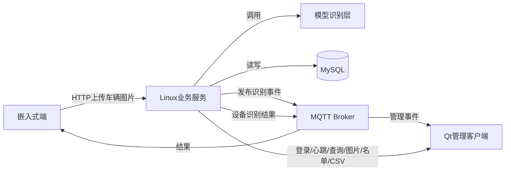
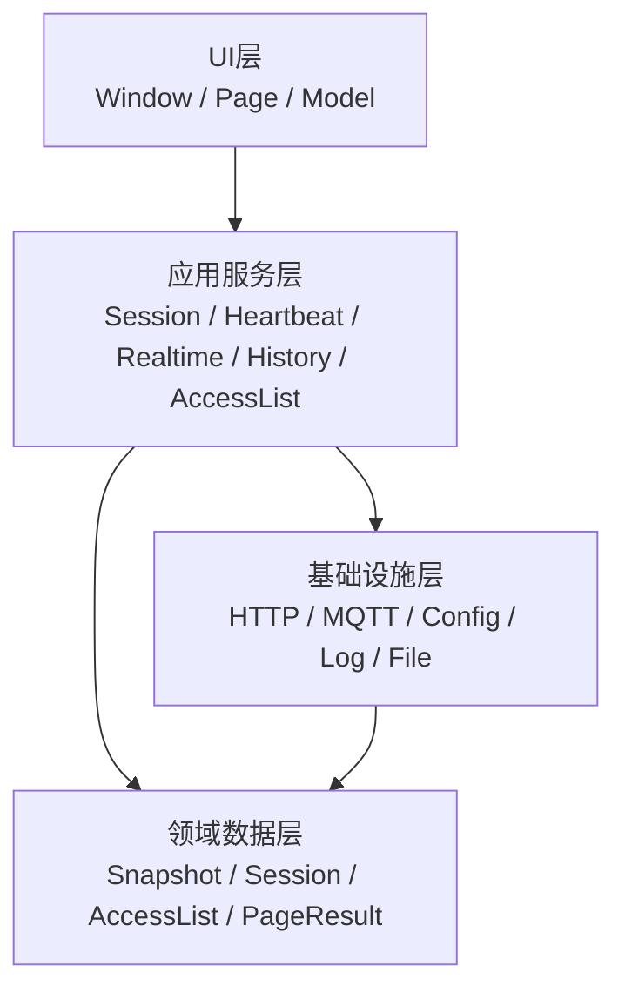
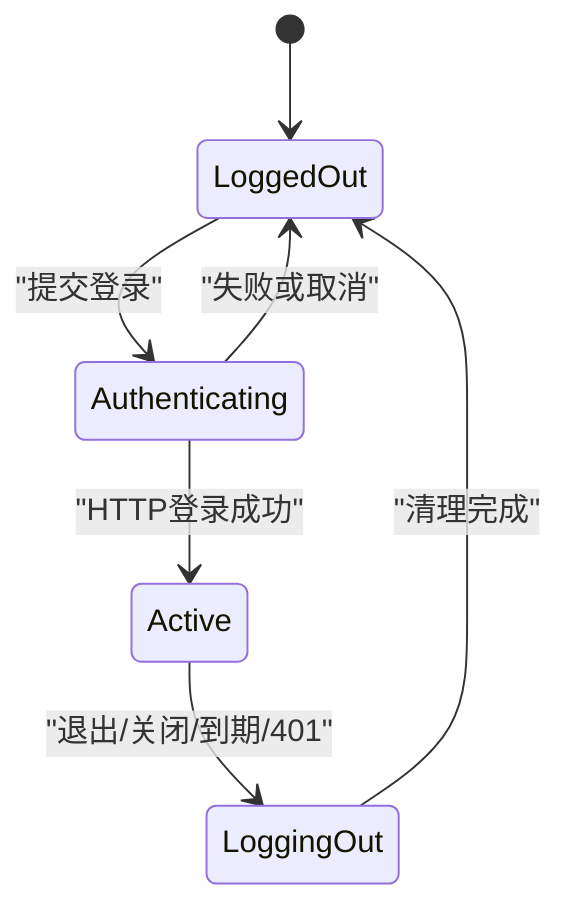
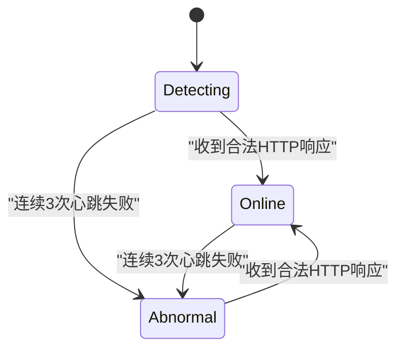
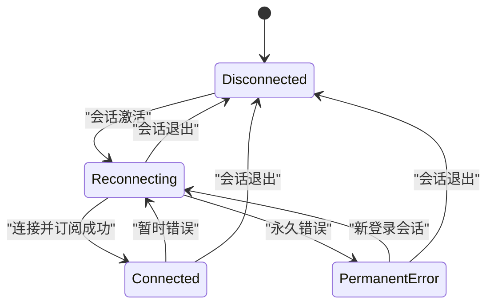
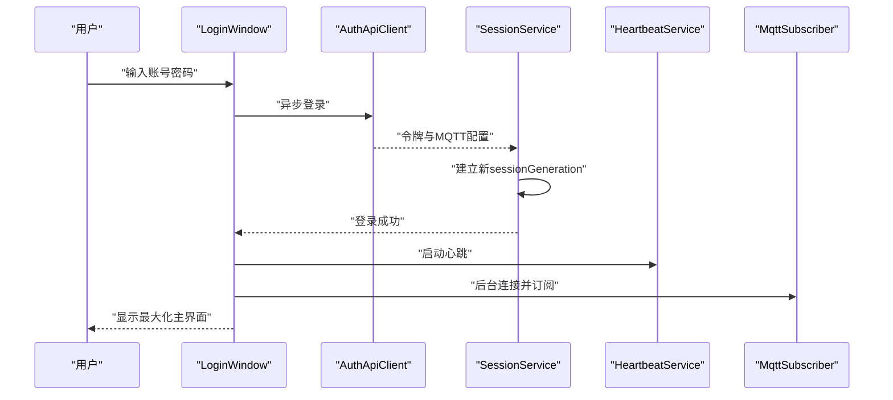
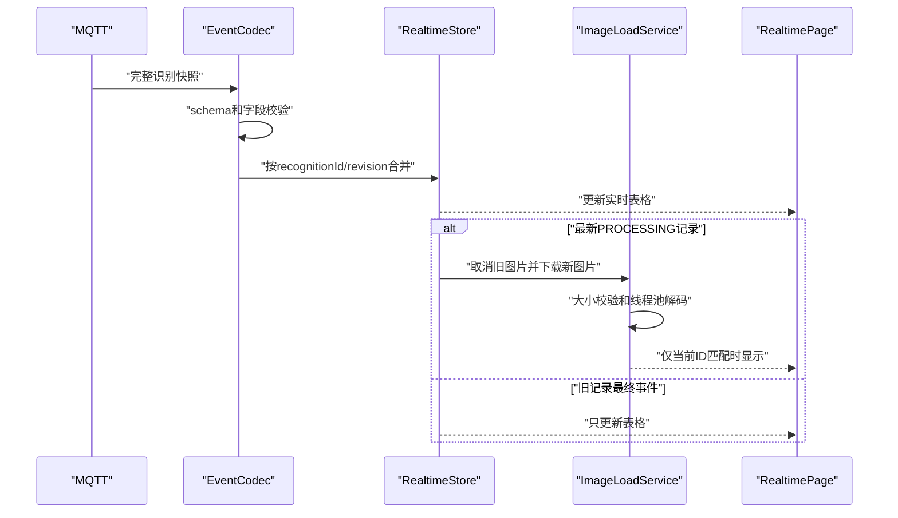
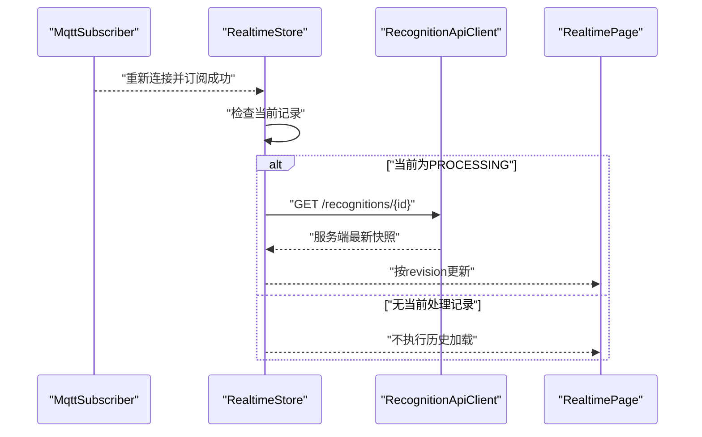

# REQ-001 Qt 车牌识别管理客户端架构设计

| 属性 | 内容 |
| --- | --- |
| 关联需求 | REQ-001 v2.1 |
| 设计版本 | 1.1 |
| 状态 | 已确认，待实现 |
| 日期 | 2026-08-11 |

## 1. 设计目标

本设计用于指导 Qt 管理客户端的后续实现，目标是：

- 保持教学项目结构清晰，不过度抽象。
- 明确 Linux 服务端负责识别和业务数据，Qt 只做管理与展示。
- 使用 Qt 异步能力保证 UI 响应。
- 防止旧网络响应、旧图片和旧登录会话污染当前界面。
- 不使用 SQLite，不建立客户端业务同步系统。
- 让每个模块可以通过可控 HTTP/MQTT Mock 独立测试。

## 2. 架构原则

1. 单进程、事件驱动、模块化单体。
2. UI 与协议解析分离，QWidget 不直接构造 HTTP/MQTT 数据。
3. Linux 服务端是识别日志和名单数据的唯一业务来源。
4. MQTT 负责实时通知，HTTP 负责可查询资源和写操作。
5. 实时页面是会话视图，不承担历史可靠存储。
6. 所有异步结果必须经过会话和请求代次验证。
7. 优先使用 Qt 模块，不引入额外运行时框架。

## 3. 系统上下文



Qt 客户端不位于服务端到嵌入式端的结果路径中。Qt 关闭不影响模型识别或嵌入式抬杆流程。

## 4. 客户端分层



依赖只允许从 UI 指向应用服务、从应用服务指向基础设施和领域数据。领域数据不得依赖 QWidget、QNetworkReply 或 QMqttClient。

## 5. 模块设计

### 5.1 应用入口

| 模块 | 职责 |
| --- | --- |
| `Application` | 初始化 Qt、组织名、应用名、日志、配置和全局对象 |
| `AppController` | 创建登录页和主窗口；控制登录、退出、关闭及页面生命周期 |
| `BootstrapConfigLoader` | 加载并校验 `client.json`，拒绝非法 URL、UUID 和传输配置 |

### 5.2 会话和连接

| 模块 | 职责 |
| --- | --- |
| `AuthApiClient` | 登录、注销、JSON 信封校验和认证错误映射 |
| `SessionService` | 保存内存会话、到期计时、会话代次和统一失效处理 |
| `HeartbeatService` | 30 秒心跳、5 秒超时、连续失败计数和 HTTP 状态通知 |
| `MqttRecognitionSubscriber` | MQTT 连接、重连、订阅、事件解析和连接状态通知 |

`SessionService` 是访问令牌和 MQTT 凭据的唯一所有者。UI 只能获得显示名、到期提示和连接状态，不得读取或记录凭据。

### 5.3 实时识别

| 模块 | 职责 |
| --- | --- |
| `RecognitionApiClient` | 查询单条记录、分页历史、下载图片和下载 CSV |
| `RecognitionEventCodec` | 校验 MQTT schema 并转换为 `RecognitionSnapshot` |
| `RealtimeRecognitionStore` | revision 去重、当前车辆选择和最近 100 条会话记录 |
| `ImageLoadService` | 当前图片下载、取消、重试、大小校验和异步解码 |
| `ReconnectReconciler` | MQTT 重连后只查询当前 `PROCESSING` 记录 |

### 5.4 历史和名单

| 模块 | 职责 |
| --- | --- |
| `HistoryService` | 组织筛选、分页和请求代次，向页面提供不可变分页结果 |
| `CsvDownloadService` | 请求服务端 CSV、显示保存对话框、流式写入和原子提交 |
| `AccessListApiClient` | 名单分页查询、精确查询、新增和删除 |
| `AccessListService` | 车牌规范化、写操作串行化、超时核实和页面刷新 |

### 5.5 UI

| 界面 | 职责 |
| --- | --- |
| `LoginWindow` | 用户名、密码、登录状态和错误提示 |
| `MainWindow` | 最大化窗口、左侧导航、页面容器和关闭事件 |
| `NavigationSidebar` | 导航、用户、HTTP/MQTT 状态、版本和退出 |
| `RealtimePage` | 当前图片、当前状态、结果信息和实时表格 |
| `HistoryPage` | 时间/设备筛选、分页表格和 CSV 下载 |
| `AccessListPage` | 黑白名单标签、搜索、分页、新增和删除 |
| `RecognitionTableModel` | 实时或历史只读表格模型 |
| `AccessListTableModel` | 名单只读表格模型 |

视频识别和摄像头识别使用禁用的导航项，不创建空白业务页面。

## 6. 建议源码目录

```text
src/
├── app/             Application、AppController
├── domain/          Session、RecognitionSnapshot、AccessListRecord、错误类型
├── services/        Session、Heartbeat、Realtime、History、AccessList服务
├── infrastructure/
│   ├── config/      引导配置
│   ├── http/        HTTP客户端适配器
│   ├── mqtt/        Qt MQTT适配器和事件解析
│   ├── files/       CSV保存和日志文件
│   └── logging/     脱敏按日日志
└── ui/
    ├── windows/     登录和主窗口
    ├── pages/       实时、历史和名单页面
    ├── models/      QAbstractTableModel实现
    └── widgets/     状态指示器等可复用控件
```

该目录是模块边界，不要求为每个类型单独建立文件。实现应避免只有一次调用的空接口和无业务价值的抽象层。

## 7. 核心数据类型

### 7.1 `BootstrapConfig`

- `clientId`
- `loginBaseUrl`
- `allowInsecureTransport`

### 7.2 `SessionContext`

| 字段 | C++/Qt 类型 | 说明 |
| --- | --- | --- |
| `displayName` | `QString` | 当前用户显示名 |
| `accessToken` | `QString` | Bearer Token |
| `expiresAt` | `QDateTime` | 带 `+08:00` 的有效期 |
| MQTT 主机、用户名、密码、主题 | `QString` | 登录响应下发 |
| MQTT 端口 | `quint16` | 1 至 65535 |
| MQTT TLS | `bool` | 是否启用 TLS |
| `generation` | `quint64` | 登录会话代次 |

`SessionContext` 只存在内存中。销毁或替换会话时清空敏感字符串。

### 7.3 `RecognitionSnapshot`

| 字段 | C++/Qt 类型 |
| --- | --- |
| `schemaVersion` | `int` |
| `recognitionId` | `QString` |
| `revision` | `qint64` |
| `deviceId` | `QString` |
| `status` | `RecognitionStatus` 枚举 |
| `plateNumber` | `std::optional<QString>` |
| `errorCode` | `std::optional<QString>` |
| `errorMessage` | `std::optional<QString>` |
| `capturedAt` | `QDateTime` |
| `startedAt` | `QDateTime` |
| `completedAt` | `std::optional<QDateTime>` |
| `durationMs` | `std::optional<qint64>` |

状态限定为 `PROCESSING`、`SUCCEEDED` 和 `FAILED`。解析器必须按 REQ-001 第 8.4 节同时校验字段类型、范围和状态相关可空性，不把缺失字段与显式 `null` 混为一类。

### 7.4 `AccessListRecord`

| 字段 | C++/Qt 类型 |
| --- | --- |
| `id` | `qint64` |
| `listType` | `AccessListType` 枚举 |
| `plateNumber` | `QString` |
| `remark` | `QString` |
| `createdBy` | `QString` |
| `createdAt` | `QDateTime` |

名单类型限定为 `WHITE` 和 `BLACK`。`remark` 始终是字符串，未填写时为空字符串，协议层不接受 `null`。

### 7.5 `RequestContext`

- `sessionGeneration`
- `requestGeneration`
- 页面或操作类型
- 可选 `recognitionId`
- 当前筛选条件快照

每个异步响应必须携带或闭包捕获不可变 `RequestContext`。

### 7.6 HTTP DTO

基础设施层使用两个通用值类型，不向 UI 暴露 `QJsonObject`：

| 类型 | 字段 |
| --- | --- |
| `HttpEnvelope<T>` | `bool success`、`QString code`、`QString message`、`QString requestId`、`std::optional<T> data` |
| `PageResult<T>` | `QList<T> items`、`int page`、`int pageSize`、`qint64 total` |
| `EmptyResponse` | 无业务字段；用于成功信封要求 `data=null` 的接口 |

`page` 从 1 开始，`pageSize` 首版固定为 100，`total` 不得为负。HTTP 适配器负责把统一信封转换为明确的成功值或错误类型；应用服务和 QWidget 不得自行读取 JSON 字段。

各接口成功值固定为：

| 接口 | 成功 DTO |
| --- | --- |
| 登录 | `SessionContext` 所需的登录 DTO |
| 心跳、注销、删除名单 | `EmptyResponse`，协议层校验 `data=null` |
| 识别详情 | `RecognitionSnapshot` |
| 识别历史 | `PageResult<RecognitionSnapshot>` |
| 名单分页 | `PageResult<AccessListRecord>` |
| 名单精确查询、新增名单 | `AccessListRecord` |
| 图片、CSV | 不使用 JSON 信封的流式二进制响应 |

字段类型、可空性、状态约束、CSV 列顺序以及 2 MB JSON 响应上限以 REQ-001 第 8 章为准。任何 DTO 解析失败均返回协议错误，不把部分对象交给应用服务。

## 8. 执行和线程模型

### 8.1 UI 线程

以下对象工作在 UI 线程：

- 所有 QWidget 和 QAbstractTableModel。
- `AppController` 和应用服务协调对象。
- `QNetworkAccessManager` 及其 QNetworkReply。
- `QMqttClient`。
- QTimer 心跳、令牌到期和 MQTT 重连调度。

QNetworkAccessManager 和 QMqttClient 本身是异步的，回调只执行解析、状态判断和信号分发，不做大图片解码或大批量数据转换。

### 8.2 线程池

线程池仅用于：

- 使用 `QImageReader` 预检并解码已下载图片字节为 `QImage`。
- 必要的非阻塞文件收尾操作。

后台结果通过 queued signal/slot 返回 UI 线程后仍需验证会话代次、图片请求代次和 `recognitionId`。线程池任务不得持有 QWidget 裸指针，也不得创建或访问 `QPixmap`；`QPixmap::fromImage()` 和界面设置只能在 UI 线程执行。

### 8.3 CSV 写入

CSV 由服务端生成。Qt 按网络数据块增量写入 `QSaveFile`，不把整个文件加载进内存。最终 `commit` 前再次验证请求未取消；失败时调用取消写入并删除临时文件。

### 8.4 HTTP 总时限和重试

HTTP 适配器在创建 `QNetworkReply` 时同时创建归属同一请求上下文的单次 `QTimer`，实现从请求发出到完整响应体接收完成的总时限。定时器到期时调用 `abort()`；完成、取消或销毁 reply 时停止定时器。超时必须映射为独立错误，不与用户取消混淆。

| 请求 | 总时限 | 客户端行为 |
| --- | ---: | --- |
| 登录 | 10 秒 | 不自动重试 |
| 注销 | 5 秒 | 不重试，不阻塞本地退出 |
| 心跳 | 5 秒 | 不立即重试，等待下一个 30 秒周期 |
| 识别详情、历史、名单分页和精确查询 | 10 秒 | 不自动重试 |
| 图片 | 30 秒 | 仅连接失败、超时或可重试 5xx 按 1 秒、3 秒重试 |
| 名单新增、删除 | 10 秒 | 不重发写请求，改用精确查询核实 |
| CSV | 120 秒 | 不自动重试 |

JSON reply 在读取前检查 `Content-Length`，读取过程中检查解码后的累计字节数，超过 2 MB 立即中止并报告响应超限。图片使用独立的 20 MB 上限；CSV 直接流式写入 `QSaveFile`，不经过 JSON 缓冲区。

重连校准失败后不循环查询。HTTP 状态以后首次从“异常”恢复为“在线”时，若当前记录仍为 `PROCESSING`，`ReconnectReconciler` 只补偿查询一次；新的 MQTT 断线重连周期可以建立新的单次补偿资格。

## 9. 状态模型

### 9.1 会话状态



### 9.2 HTTP 状态



合法的 4xx/5xx 证明 HTTP 服务可访问，但具体请求仍按失败处理。401 额外触发会话退出。

### 9.3 MQTT 状态



只有 MQTT CONNECT 和主题订阅都成功后才进入 `Connected`。错误分类如下：

| 分类 | 错误 | 行为 |
| --- | --- | --- |
| 暂时错误 | 网络中断、连接超时、Broker 暂不可用 | 进入 `Reconnecting`，按 1、2、4 秒递增到 60 秒上限重连 |
| 永久错误 | 用户名或密码错误、无权限、Client ID 被拒绝、协议不支持、订阅失败、TLS 证书错误 | 进入 `PermanentError`，停止当前会话的重连定时器 |

`PermanentError` 在导航栏仍映射为 MQTT“未连接”，并附加“配置或授权错误”及脱敏原因。该状态不使 HTTP 会话失效，历史、CSV 和名单功能继续可用；只有创建新的登录会话后才清除该错误并再次连接。TLS 证书错误不得转为暂时错误或被忽略。

### 9.4 当前车辆状态

- 无当前记录：显示“未启动识别”。
- 当前快照为 `PROCESSING`：显示“识别中”。
- 当前快照为 `SUCCEEDED`：显示“已识别完成”和车牌号。
- 当前快照为 `FAILED`：显示“已识别完成”和红色错误信息。

## 10. 登录时序



主界面展示不依赖 MQTT 连接完成。MQTT 初始状态为重连中。

## 11. 实时事件和图片时序



## 12. 图片加载设计

1. 新的当前 `PROCESSING` 到达时递增图片请求代次。
2. 取消上一 QNetworkReply 和尚未触发的重试定时器。
3. 调用固定图片接口，设置 30 秒总时限和 20 MB 压缩响应体上限。
4. 连接失败、超时或可重试 5xx 时，按 1 秒和 3 秒重试。
5. 4xx、非 `image/jpeg`/`image/png`、压缩体超限或解码失败直接进入最终失败显示。
6. 将已完成下载的不可变 `QByteArray` 和请求上下文提交到线程池；工作任务不得捕获 QWidget。
7. 在线程池中用 `QBuffer` 构造 `QImageReader`，先调用 `size()`；尺寸无效、宽或高大于 8192，或使用 64 位乘法计算的总像素大于 4000 万时，不调用 `read()`。
8. 在线程池中解码为 `QImage`，解码后再次检查非空、实际宽高和总像素，防止元数据尺寸与实际结果不一致。
9. 通过 queued signal/slot 把只读 `QImage` 和请求上下文送回 UI 线程，再次验证会话代次、图片请求代次和当前 `recognitionId`；失效结果直接丢弃。
10. 仅在 UI 线程调用 `QPixmap::fromImage()` 并更新 QWidget。最终失败显示占位和手动重试按钮，不改变识别结果状态。

图片下载的失败只影响管理端展示，不产生业务识别错误或 MQTT 消息。

## 13. MQTT 重连校准



查询失败时保留当前状态。HTTP 后续恢复在线时，如果当前仍是 `PROCESSING`，允许再次发起一次校准。

## 14. 历史查询和 CSV

- `HistoryPage` 修改筛选或页码时递增页面请求代次。
- `HistoryService` 捕获完整筛选条件并发起请求。
- 旧代次响应只记录调试信息，不修改表格和分页状态。
- 查询失败保留当前表格，显示非阻断错误。
- 导出时将当前筛选条件发送给服务端 CSV 接口。
- 保存对话框取消时不发起下载。
- 下载进行中禁用重复导出，但不阻塞页面浏览。
- 导出失败不改变当前查询结果。

## 15. 黑白名单设计

### 15.1 查询

- 当前标签决定 `listType`。
- 搜索关键字执行首尾去空白和英文字母转大写。
- 搜索、标签切换、分页和刷新均递增请求代次。
- 旧查询结果不得覆盖当前标签或当前关键字。

### 15.2 新增

1. 从当前标签取得名单类型。
2. 校验车牌号和可选备注。
3. 禁用对话框提交按钮，避免重复提交。
4. 服务端成功后关闭对话框并重新查询当前页。
5. HTTP 409 显示车牌已存在及现有名单类型。
6. 连接超时后调用精确查询接口核实。
7. 查询到目标类型记录时提示已生效；查询不到时提示未生效；核实失败时提示无法确认。

### 15.3 删除

1. 仅允许删除当前选中记录。
2. 确认对话框显示名单类型和车牌号。
3. 请求期间禁用该页面的重复删除操作。
4. 成功后重新查询当前页。
5. 如果删除后当前页为空且页码大于 1，则查询上一页。
6. 连接超时后精确查询；查不到目标车牌时视为已删除。
7. 404 视为记录已经不存在，提示后刷新。

客户端不通过本地插入或删除制造“看起来成功”的结果。

## 16. 退出和销毁顺序

退出登录或关闭窗口时按以下顺序执行：

1. 将会话状态切换为 LoggingOut 并递增会话代次。
2. 停止心跳、令牌到期和 MQTT 重连定时器。
3. 取消所有 QNetworkReply 和图片重试定时器。
4. 使用当前令牌构造并发送尽力注销请求；请求不允许更新业务 UI，也不得阻止本地退出。
5. 断开 MQTT 并清除订阅。
6. 清空实时记录、页面模型、当前图片、访问令牌和 MQTT 凭据。
7. 销毁主窗口并显示登录页，或结束进程；关闭应用时不等待注销响应。

所有回调使用 QObject 上下文连接或 QPointer 防护，不捕获无生命周期保证的 QWidget 裸指针。

## 17. 错误处理

| 错误 | 客户端行为 |
| --- | --- |
| HTTP 401 | 统一退出登录 |
| HTTP 400/403/404/409 | 在对应页面显示业务提示，HTTP 网络状态保持在线 |
| HTTP 5xx | 显示服务错误，HTTP 网络状态保持在线 |
| 连接失败/超时 | 计入心跳失败或显示请求错误，保留现有页面数据 |
| MQTT 暂时连接错误 | 显示重连中并按退避重连 |
| MQTT 永久连接或订阅错误 | 停止当前会话自动重连，显示未连接及脱敏原因，保留 HTTP 功能 |
| MQTT 消息非法 | 丢弃并写脱敏技术日志 |
| 图片错误 | 重试或显示占位，不修改识别业务状态 |
| CSV 下载错误 | 取消 QSaveFile，不留下不完整文件 |
| 名单写入结果不明 | 精确查询服务器状态，不猜测结果 |
| 旧异步响应 | 静默丢弃，不修改 UI |

## 18. 技术日志

- 采用 Qt 文件 API 实现简单按日日志，不引入日志框架。
- 文件名包含本地日期，启动时删除超过 7 天的日志。
- 记录时间、级别、模块、错误码、requestId、recognitionId 和必要上下文。
- 不记录密码、令牌、MQTT 密码、Authorization 头、完整 MQTT 载荷或完整图片响应。
- 日志写入失败不得阻止应用启动或网络流程。

## 19. 安全设计

- 访问令牌和 MQTT 凭据只保存在 `SessionContext` 内存对象。
- QNetworkRequest 统一添加 Bearer Token，日志层统一脱敏请求头。
- 图片只能按 `recognitionId` 调用固定服务端接口。
- `allowInsecureTransport=false` 时拒绝明文地址。
- TLS 错误必须显示并终止对应请求，不提供忽略证书选项。
- JSON 响应限制为 2 MB；图片压缩体限制为 20 MB，宽高分别限制为 8192 像素且总像素限制为 4000 万；CSV 使用流式保存避免内存膨胀。
- 备注最多 200 个字符，识别错误信息最多 512 个字符；协议层在构造领域对象前执行限制。

## 20. 测试架构

### 20.1 单元测试

- 引导配置校验。
- 登录和统一 JSON 信封解析。
- HTTP DTO 类型、必填字段、状态相关可空性、分页边界和 2 MB 上限。
- MQTT 事件字段、状态和 revision 去重。
- MQTT 暂时错误、永久错误、订阅失败和新会话状态转换。
- 实时列表上限和当前车辆选择。
- 车牌规范化和名单冲突响应映射。
- HTTP/MQTT 状态转换。
- 会话代次和请求代次失效判断。
- 图片重试计数和旧图片结果拒绝。
- 图片宽高、总像素、无效尺寸和解码后尺寸二次校验。

### 20.2 组件测试

- 可控 HTTP Mock 返回成功、4xx、5xx、超时和延迟乱序响应。
- HTTP Mock 对每类请求验证总时限，只允许图片重试，并验证名单 POST/DELETE 超时后未被重复发送。
- Mosquitto/Qt MQTT Mock 发送重复、乱序和非法事件。
- MQTT Mock 分别模拟 Broker 暂不可用、认证/授权拒绝、Client ID 拒绝、协议拒绝和订阅失败；TLS Mock 验证证书错误停止重连。
- `RealtimePage` 验证旧车辆完成不抢占当前图片。
- 图片测试使用压缩体小于 20 MB 但宽高或总像素超限的 JPEG/PNG，验证 `QImage` 在线程池生成、`QPixmap` 只在 UI 线程创建。
- `HistoryPage` 和 `AccessListPage` 验证快速筛选时只应用最后响应。
- CSV 测试验证固定表头顺序、取消和失败不留下目标文件。
- 名单超时测试验证精确查询后的成功、失败和未知三种结果。

### 20.3 端到端测试

- 登录、心跳、MQTT 连接、PROCESSING 图片和最终结果闭环。
- MQTT 中断后当前记录校准。
- HTTP 和 MQTT 独立故障状态。
- MQTT 永久错误时停止重连并保留 HTTP 页面操作，新登录会话允许重新连接。
- 名单查询、新增、重复冲突、删除和超时核实。
- 1 秒 1 条事件持续输入时 UI 响应和 100 条列表上限。
- 退出时存在 HTTP、图片解码和 MQTT 回调，验证无崩溃和越界更新。

## 21. 需求追踪

| 需求区域 | 主要模块 |
| --- | --- |
| FR-010 至 FR-017 | AuthApiClient、SessionService、LoginWindow |
| FR-020 至 FR-028 | HeartbeatService、NavigationSidebar |
| FR-030 至 FR-039 | MqttRecognitionSubscriber、ReconnectReconciler |
| FR-040 至 FR-054 | RealtimeRecognitionStore、ImageLoadService、RealtimePage |
| FR-060 至 FR-067 | HistoryService、CsvDownloadService、HistoryPage |
| FR-070 至 FR-087 | AccessListService、AccessListApiClient、AccessListPage |
| FR-090 至 FR-095 | AppController、MainWindow、NavigationSidebar |

## 22. 明确限制

- 实时首页不自动补齐全部断线记录。
- 不实现离线日志或名单访问。
- 不实现本地数据库和业务数据迁移。
- 不实现名单实时广播和冲突编辑。
- 不实现模型、MySQL 和嵌入式端健康状态展示。
- 不把黑白名单接入放行决策。

这些限制是已确认的教学项目边界，不应在实现阶段自行扩展。
